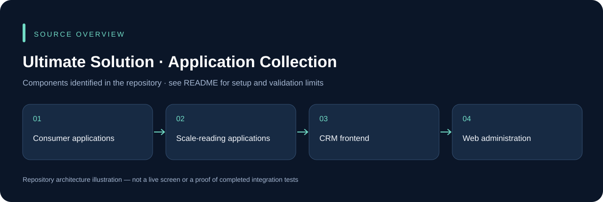

# Ultimate Solution · Application Collection

A collection of related business-application projects. Each subproject has its own dependencies and configuration; this repository is not a single one-command application.

## Choose a project

| Location | Purpose |
| --- | --- |
| `Consumer App/ConsumerNative/` | React Native consumer client |
| `Consumer App/ConsumerWebAPI/` | Consumer API source |
| `Scale App/DigitalWeightReader/` | React Native scale-reading client |
| `Scale App/BackendWeightReader/` | Scale API source |
| `Customer-Relations-Management-main/` | CRM frontend |
| `webProject/materially-free-react-admin-template-1.0.0/` | Web administration client |

## Local development

For a React/Vite frontend, enter its directory, run `npm ci`, then the package's `dev` or `start` script. For a React Native client, restore dependencies, start Metro with `npm start` and build with `npm run android`; iOS requires macOS/Xcode. Build each .NET API using its own `.csproj`, supplying a compatible private test database and settings.

Do not share one project's environment file or signing identity across unrelated deployments. Native camera/scale integrations, live synchronization, consumer workflows and external services require project-specific checks. The image in this README is a source overview, not a claim that every included application was run.

## Source overview

This diagram is derived from the repository structure; it is not an application screenshot.

## Development and validation

Use an isolated development database and synthetic records. Keep credentials, device sessions, signing keys and operational uploads outside Git. The presence of source code does not establish that every integration or deployment scenario has been tested. See [repository review](docs/REPOSITORY_REVIEW.md) for this audit's scope.

## Ownership and contributions

Existing author, template, asset and dependency attributions remain in place. Follow any existing license files; this documentation update does not grant a new license. For a change, describe the affected workflow, configuration and checks so it can be reviewed without guessing.
